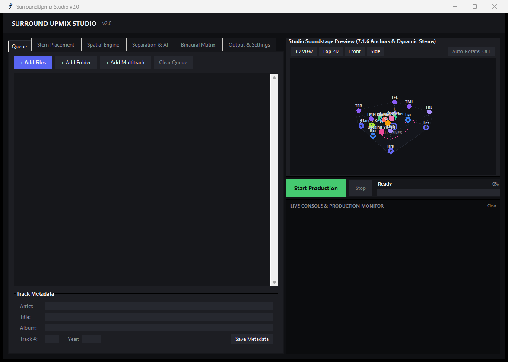
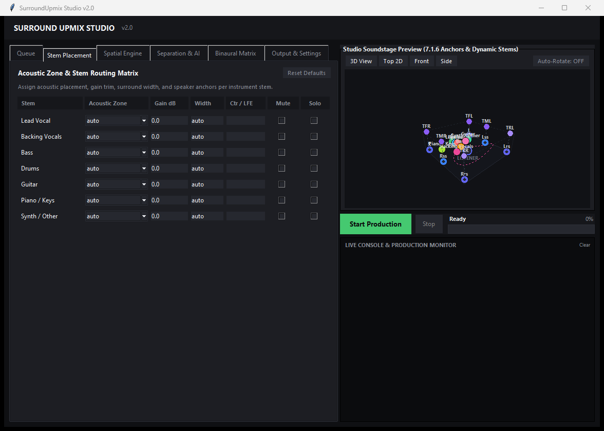
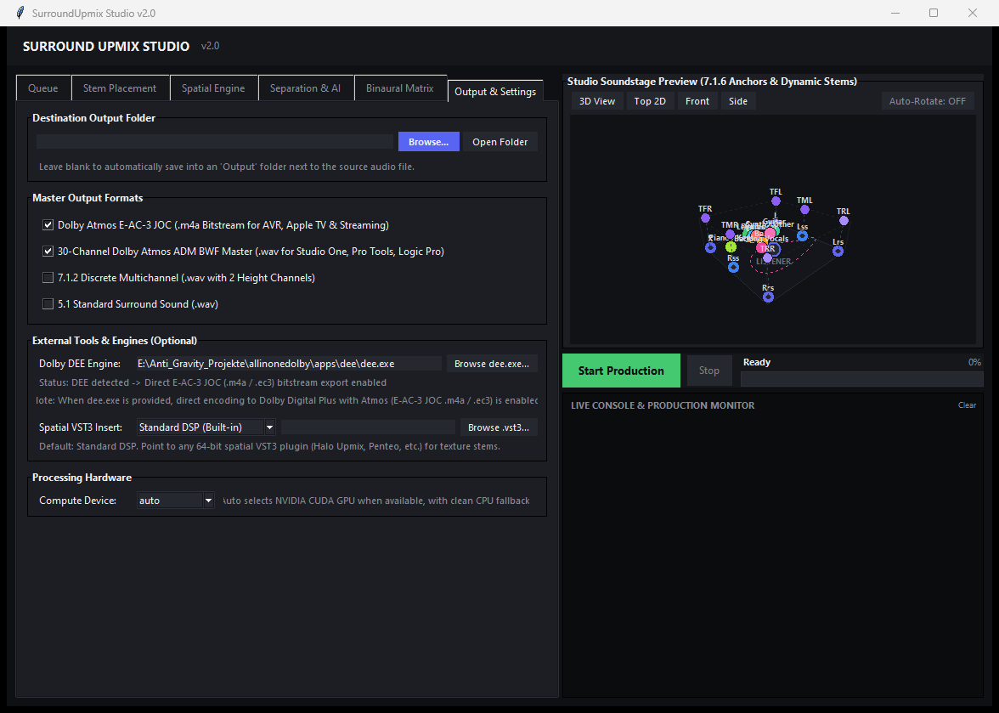

# SurroundUpmix v2.0

Stems-based spatial audio upmixer and authoring suite for 5.1, 7.1, 7.1.2, and broadcast-grade Dolby Atmos ADM BWF masters. Runs locally on Windows, macOS, and Linux using open-source audio toolchains and PyTorch DSP.

[](https://github.com/final-wav/SurroundUpmix/releases)
[](https://www.python.org/)
[](#license)

<p align="center">
  
</p>

---

## What's New in v2.0

- **Standard DSP Engine**: Frequency-dependent energy-conserving direct/ambient signal decomposition based on short-time complex coherence. Preserves front pin-point transient clarity while extracting diffuse acoustic room reflections to surround and height channels.
- **Chunked Streaming ADM BWF Writer (Resolves Issue #1)**: Continuous streaming disk writer operating in 96,000-sample blocks (~2.0 seconds). Fixes memory allocation errors (`ArrayMemoryError`) on multi-hour recordings and live sets, maintaining a constant RAM footprint below 25 MB regardless of file duration.
- **Granular Stem Placement & Acoustic Routing Matrix**: Interactive per-instrument routing table allowing precise zone assignment (Front, Side, Rear, Heights, 3D Orbit), volume trim (dB), surround spread, center/LFE direct sends, and mute/solo controls.
- **DrumSep Sub-Drum Separation**: Neural drum decomposition separating mixed drum tracks into discrete kick, snare, cymbals/hi-hats, and toms for precise 3D spatial positioning.
- **Binaural Matrix Calibration**: Integrated binaural headphone monitoring preview with per-object HRTF rendering mode controls (Off, Near, Mid, Far).
- **Studio Multitrack Folder Ingest**: In addition to standard stereo audio files, ingest entire DAW multitrack stem directories with automated role detection and speaker assignment.
- **Flexible Master Output Selection**: Independent multi-format export checkboxes allowing simultaneous export of 30-channel ADM BWF (.wav), Dolby Atmos E-AC-3 JOC (.m4a bitstream via optional DEE), 7.1.2 discrete, and 5.1 surround.
- **Optional VST3 Plugin Bridge & Dolby DEE**: Optional path configuration for external spatial VST3 plugins and Dolby Encoding Engine (dee.exe) with automatic 8.3 short path handling to prevent space-parsing issues.
- **Dual-Mode Graphical Interface**:
  - **Studio GUI (`gui.py`)**: Dark-themed production interface featuring an interactive 3D perspective soundstage canvas (orbit rotation, pitch, pan, and zoom), real-time monitor console, and drag-and-drop batch processing.
  - **Classic GUI (`gui_classic.py`)**: Preserves the legacy interface for users requiring manual slider fine-tuning.

---

## Overview

Traditional upmixing algorithms widen a stereo track by applying artificial phase inversions or static delays, which smears instruments indiscriminately across speaker channels and causes destructive comb filtering in mono downmixes.

SurroundUpmix takes a stems-first acoustic approach:
1. Decomposes the input recording into discrete musical stems (vocals, drums, bass, other, and optionally guitar, piano, and drum sub-stems) using neural source separation (Demucs / Roformer / DrumSep).
2. Computes the short-time complex inter-channel coherence ($\gamma$) for each stem to separate direct localized sound from diffuse acoustic room reflections.
3. Anchors dry, localized elements firmly in the front stage while enveloping the listener with natural room reverberation, overhead reflections, and spatial textures across surround and height speakers.
4. Authors broadcast-ready Dolby Atmos ADM BWF (RF64/BW64) masters with ITU-R BS.2076 metadata, complete with fixed speaker anchors and automated 3D audio object trajectories.

---

## Signal Processing & Physics

### 1. Energy-Conserving Coherence Decomposition

A stereo master contains both direct instrumentation and diffuse acoustic space mixed into two channels. For each stem, the engine computes the short-time complex inter-channel coherence:

$$\gamma(f, t) = \frac{|\langle L \cdot R^* \rangle|}{\sqrt{\langle |L|^2 \rangle \cdot \langle |R|^2 \rangle}} \quad (0 \le \gamma \le 1)$$

The signal is decomposed into direct and ambient components:

$$\text{Direct} = X \cdot \gamma$$
$$\text{Ambient} = X \cdot \sqrt{1 - \gamma^2}$$

Because $\gamma^2 + (1 - \gamma^2) = 1$, total energy is strictly conserved in every time-frequency bin:
- Dry, centered, or cleanly panned sources ($\gamma \to 1$) are directed to the front stage, preserving their original stereo placement.
- Diffuse reverb and ambient spread ($\gamma \to 0$) wrap smoothly around the listener into side, rear, and top height channels.

### 2. Stem-Specific Acoustic Routing

Routing rules are grounded in real room acoustics rather than artificial panning:

- **Bass**: Routed exclusively to the front and LFE. Low frequencies are non-directional; routing bass into surround channels causes room muddiness and phase cancellation.
- **Drums**: Kick and snare remain anchored at the front. Decorrelated drum room ambience, overhead spill, and cymbals wrap into surround and height channels.
- **Lead Vocal**: Anchored to the center and front stage. Short-delay doubled vocals (hard-panned double takes) are detected via GCC-PHAT and kept forward to prevent comb-filtering.
- **Backing Vocals**: When isolated via vocal separation, backing harmonies wrap into the rear and side channels with dedicated front anchors for balanced vocal clarity.
- **Instruments / Textures**: Dry guitars, keyboards, and synths remain in the front stage, while their natural room reflections and stereo tails wrap to the sides and rear according to measured diffuseness.
- **LFE Channel**: Synthesized from the sub-bass of bass and kick drums, band-limited via crossover (high-passed at 20 Hz), and calibrated with standard ITU-R BR.1384 reproduction offsets.
- **Heights (7.1.2 / 7.1.6)**: Fed by high-passed, decorrelated ambient reflections to create an open overhead canopy rather than a muffled clone of the mix.

---

## Dolby Atmos & ADM BWF Masters

SurroundUpmix authors compliant **Dolby Atmos ADM BWF** (RF64 / BW64) masters containing ITU-R BS.2076 `axml` and `chna` metadata, ready for direct import into the Dolby Atmos Renderer, Studio One, Pro Tools, Logic Pro, and DaVinci Resolve.

### 30-Channel Master Architecture (`--all-objects`)

- **Channels 1–10**: 7.1.2 Bed Carrier with silent PCM (`0.0`). Provides standard DAW compatibility on ADM import, preventing *"File does not contain beds"* errors.
- **Channels 11–24**: 14 Fixed Speaker Anchors configured in a 7.1.6 room layout:
  - Front Left, Center, Front Right: $(\pm 1.0, 1.0, 0.0)$, $(0.0, 1.0, 0.0)$
  - LFE / Subwoofer: $(0.0, 0.8, 0.0)$
  - Side Surrounds L/R: $(\pm 1.0, 0.0, 0.0)$
  - Rear Surrounds L/R: $(\pm 1.0, -1.0, 0.0)$
  - Top Front L/R: $(\pm 1.0, 1.0, 1.0)$
  - Top Middle L/R: $(\pm 1.0, 0.0, 1.0)$
  - Top Rear L/R: $(\pm 1.0, -1.0, 1.0)$
- **Channels 25–30**: 6 Dynamic Moving 3D Audio Objects with automated real-time spatial trajectories:
  - **Lead Vocal**: Intimate whisper proximity tracking and pitch-to-elevation dynamics.
  - **Backing Left & Right**: Continuous 360° orbit around the listener.
  - **Guitar / Solo**: Short-time energy pan tracking across the stereo plane.
  - **Piano / Synth**: Dynamic width expansion with ceiling elevation.
  - **Ear Candy / FX**: Spatial risers and 3D delay swirls.

### Zero-OOM Streaming Writer

In previous versions, writing a 30-channel ADM file required allocating the entire multichannel float32 matrix in RAM at once. For recordings longer than 45–60 minutes, this triggered `ArrayMemoryError` crashes requiring tens of gigabytes of RAM.

In v2.0, audio is streamed directly to disk in 96,000-sample blocks (~2.0 seconds):
- Constant memory consumption below 25 MB RAM.
- Supports recordings of arbitrary duration (concerts, DJ mixes, soundtracks).
- Compliant ITU-R BS.2076 chunk headers.

---

## Presets

| Preset | Spatial Character |
| :--- | :--- |
| `focus` | Vocal-forward staging with subtle ambient surround wrap. |
| `immersive` | **Default**. Balanced acoustic staging; natural room envelopment. |
| `concert` | Expansive soundstage with pronounced side, rear, and height reflection. |
| `envelop` | Maximum surround wrapping for ambient, electronic, and cinematic material. |

---

## Installation

### Requirements
- Python 3.9, 3.10, or 3.11
- Recommended: NVIDIA GPU with CUDA for neural separation acceleration

```bash
# Windows 1-Click Installation:
# Double-click install.bat to automatically install all dependencies!

# Or manual installation:
git clone https://github.com/final-wav/SurroundUpmix.git
cd SurroundUpmix
pip install -r requirements.txt
```

> **CUDA Acceleration**: For PyTorch with NVIDIA GPU acceleration, install the appropriate wheel from [pytorch.org](https://pytorch.org/):
> ```bash
> pip install torch torchaudio --index-url https://download.pytorch.org/whl/cu121
> ```

---

## Usage

### 1. Graphical Interface (GUI)

Launch the Studio GUI with interactive 3D soundstage visualization:
```bash
python gui.py
# On Windows: double-click run_gui.bat
```

To launch the classic interface with individual sliders:
```bash
python gui_classic.py
```

#### Stem Placement & Acoustic Routing Matrix
Granular per-instrument zone assignments, width, level trims, center/LFE sends, and mute/solo controls:

<p align="center">
  
</p>

#### Master Deliverables & External Engines
Independent multi-format export checkboxes (30-ch ADM BWF, E-AC-3 JOC bitstream, 7.1.2, 5.1) and Dolby Encoding Engine (DEE) integration:

<p align="center">
  
</p>

### 2. Command Line Interface (CLI)

#### All-in-One End-to-End Pipeline
Processes any audio file or multitrack directory directly to 30-channel Dolby Atmos ADM BWF or multichannel audio:
```bash
# 30-channel Dolby Atmos ADM BWF master with dynamic 3D motion objects
python cli.py "song.flac" --format adm --objects --device cuda

# Simultaneous 30-channel ADM BWF Master and Dolby Atmos E-AC-3 JOC bitstream
python cli.py "song.flac" --format adm,ec3 --preset immersive

# Multichannel 7.1.2 discrete surround
python cli.py "song.wav" --format 7.1.2 --preset concert

# Drag-and-drop on Windows:
# Drag your audio file or folder directly onto run_cli.bat!
```

#### Stems Directory Ingest
```bash
python cli.py "path/to/stems_folder" --format adm
```

---

## Repository Structure

```
SurroundUpmix/
├── surroundupmix/              # Core DSP and ADM authoring package
│   ├── adm.py                  # ITU-R BS.2076 ADM BWF streaming writer & Dolby metadata
│   ├── balance.py              # Front/rear balance & LUFS loudness calibration
│   ├── binaural.py             # Binaural spatial cues & HRTF preview
│   ├── decompose.py            # Standard DSP energy-conserving coherence decomposition
│   ├── detect.py               # GCC-PHAT doubled vocal phase detection
│   ├── dolby_signature_30ch.bin# Dolby Atmos 30-channel binary signature
│   ├── dsp.py                  # Linear-phase filters & all-pass decorrelators
│   ├── engine.py               # Multichannel stems mixing orchestrator
│   ├── inputs.py               # Audio input probing & format validation
│   ├── io.py                   # High-speed RF64 / BW64 / FLAC audio I/O
│   ├── layouts.py              # Channel masks for 5.1, 7.1, 7.1.2, 7.1.4, 7.1.6
│   ├── motion.py               # 3D spatial trajectories (orbit, rise, whisper, pan)
│   ├── nugen.py                # Optional VST3 plugin bridge
│   ├── overrides.py            # Multitrack stem custom acoustic overrides
│   ├── presets.py              # Presets (focus, immersive, concert, envelop)
│   ├── recover.py              # Neural residual micro-detail recovery
│   ├── routing.py              # Acoustic routing matrices & LFE crossover
│   ├── split.py                # Stem separation dispatch (Demucs / Roformer)
│   ├── stemnames.py            # Automatic multitrack stem name resolution
│   └── voice.py                # Vocal role classification & guardrails
├── gui.py                      # Studio GUI with interactive 3D soundstage
├── gui_classic.py              # Granular classic GUI with manual sliders
├── cli.py                      # Unified CLI interface
├── pipeline.py                 # Core production pipeline engine
├── config.py                   # User settings & external tool registry
├── binaural_matrix.py          # Binaural matrix processing utilities
├── analyze_motion_events.py    # Spatial motion verification tool
├── install.bat                 # Windows 1-click dependency installer
├── run_gui.bat                 # Alternative GUI batch launcher
├── run_cli.bat                 # Windows drag-and-drop CLI runner
└── requirements.txt            # Python dependencies
```

---

## Troubleshooting & FAQ

#### Q: How does v2.0 fix `ArrayMemoryError` (OOM)?
In previous versions, ADM files were assembled by building a single NumPy array of shape `(samples, 30)` in 32-bit floating point. For a 1-hour audio track, this required allocating tens of gigabytes of contiguous RAM at once. In v2.0, `surroundupmix/adm.py` streams audio directly to disk in 96,000-sample chunks, reducing memory consumption to < 25 MB regardless of track length.

#### Q: Can I run this without external plugins or proprietary DAWs?
**Yes.** SurroundUpmix v2.0 is 100% self-contained with its built-in Standard DSP engine and does not require any paid DAWs or commercial plugins. The generated ADM BWF files can be imported directly into any Dolby Atmos-compatible DAW (Pro Tools, Logic Pro, DaVinci Resolve Studio, Nuendo, Studio One) or the Dolby Atmos Production Suite.

#### Q: How does Dolby Encoding Engine (DEE) integration work?
When an optional `dee.exe` path is provided in Output & Settings, SurroundUpmix can directly encode the 30-channel master into a Dolby Digital Plus with Atmos (E-AC-3 JOC .m4a) bitstream. Windows 8.3 short paths are automatically resolved to prevent XML parser space-truncation issues. Without DEE, the software produces broadcast-ready 30-channel ADM BWF (.wav) masters for immediate DAW import.

---

## License

Released under open-source terms. Third-party components and models are governed by their respective licenses (Demucs: MIT; ITU-R BS.2076 / ADM specifications: ITU).
